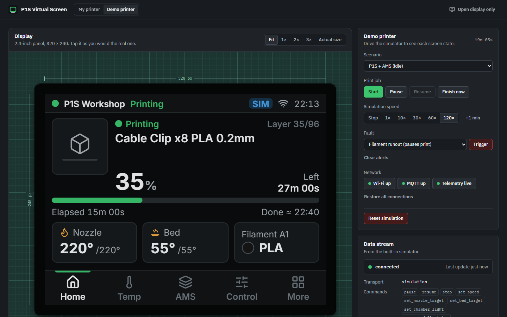
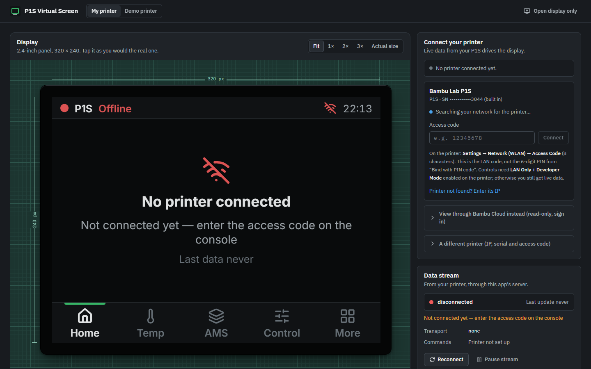
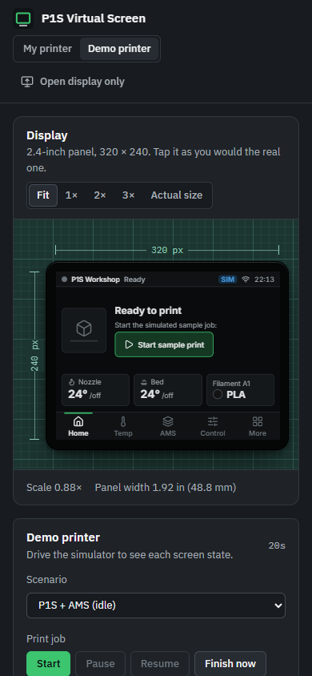

<div align="center">


# P1S Virtual Screen

**A 320 × 240 touchscreen for the Bambu Lab P1S + AMS that shows your printer's live data, built in
the browser as the reference for an ESP32-S3 + LVGL hardware display.**

[](https://github.com/satyaidk/P1S-virtual-screen/actions/workflows/ci.yml)


[Getting started](#getting-started) · [Usage](#usage) · [Architecture](#architecture) ·
[Documentation](#documentation) · [Roadmap](#roadmap)



</div>

## Overview

P1S Virtual Screen is a fixed 320 × 240 touch interface for a Bambu Lab P1S with AMS, plus a
development console around it. It connects to the real printer over the local network (or through
Bambu Cloud, read-only) and shows temperatures, job progress, AMS trays and errors.

The project is the reference implementation for a future ESP32-S3 + LVGL hardware display. Screens,
the state model and command rules are proven here first, then ported. Everything under
`src/printer` and `src/display` is framework-free TypeScript written to carry over to C.

> **Status:** the live connection is implemented and tested against a real MQTT broker with a
> simulated P1S, and against mocked Bambu Cloud responses. It has **not** yet been run against a
> physical printer. Please report what you see on yours.

## Key features

- **One-field setup.** The printer's serial number is built in and its IP address is discovered
  automatically, so connecting takes only the 8-character LAN access code.
- **Complete display.** Home (job, progress, ETA, temperatures, active filament), temperature
  control, AMS trays, print control (pause/resume, stop with confirmation, speed presets, light),
  printer info, settings and notifications.
- **Honest states.** Offline, connecting, idle, preparing, printing, paused, finished,
  cancelled/failed, error and stale telemetry each have a defined look; unknown values are shown as
  unknown, never invented.
- **Safe commands.** Every command is validated, acknowledged by the printer and confirmed by
  observed state; only idempotent commands are retried.
- **Two connection paths.** LAN over verified TLS (with control), or Bambu Cloud from anywhere
  (view-only), including the hosted Vercel deployment.
- **Development console.** The display on a measured stage (Fit, 1×, 2×, 3×, actual physical size),
  printer setup beside it, a live data-stream panel, an activity log and the exact state object the
  display renders.
- **Demo simulator** (development only): heaters, preparation stages, speed-dependent progress,
  fault injection, network loss and frozen telemetry.

## Demo

| Connect your printer                                                                                                | Phone width                                                                                                          |
| ------------------------------------------------------------------------------------------------------------------- | -------------------------------------------------------------------------------------------------------------------- |
|  |  |

In live mode the access-code form sits beside the display, so the instruction on the screen and the
field that answers it are visible together. On narrow screens the display scales to fit the width.

To try it without a printer, run the app and open `http://localhost:3000/?demo=1`.

## Architecture

```text
┌──────────────────────────── Browser ─────────────────────────────┐
│  Virtual display (React, fixed 320×240)    Development console    │
│        │  usePrinter(selector)                    │               │
│        ▼                                          ▼               │
│  zustand store  ◄── PrinterRuntime ──► EventLog, telemetry history │
│                        │      │                                   │
│               CommandManager  │ subscribe / getState              │
│                        ▼      ▼                                   │
│                   PrinterProvider (interface)                     │
│           ┌────────────────┴──────────────────┐                   │
│ SimulatedPrinterProvider            BridgePrinterProvider (live)  │
│   (demo only, ?demo=1)              ConnectionManager + SseSocket │
│                                     parseReport → mergeTelemetry  │
└───────────────────────────────────────────┬──────────────────────┘
                                            │ SSE + POST
              Next.js server (src/server): BambuCloudClient, PrinterLink, session store
                                            │ MQTT over TLS :8883
                    Bambu Cloud broker (read-only)  or  P1S on the LAN
```

The browser never holds printer credentials. The Next.js server keeps the MQTT session, merges the
P1's partial reports into a full state and relays commands; displays subscribe over Server-Sent
Events. See [docs/architecture.md](docs/architecture.md) for layers, data flow and trade-offs.

## Getting started

### Prerequisites

- Node.js 22 (the version CI uses) and npm
- A Bambu Lab P1S on the same network as the computer running the app (not needed for the demo)

### Install

```bash
git clone https://github.com/satyaidk/P1S-virtual-screen.git
cd P1S-virtual-screen
npm install
```

### Configure

No configuration is needed for the default printer. Optional settings live in `.env.example`; copy
it to `.env.local` to change them:

| Variable                                     | Purpose                                                                        |
| -------------------------------------------- | ------------------------------------------------------------------------------ |
| `BAMBU_PRINTER_SERIAL`, `BAMBU_PRINTER_NAME` | The printer this app is built for (defaults in `src/server/printer-config.ts`) |
| `BAMBU_PRINTER_HOST`                         | Fixed printer IP, for networks that block discovery broadcasts                 |
| `P1S_DATA_DIR`                               | Where the server keeps the session and chosen printer (default `.data`)        |
| `P1S_ALLOW_LAN_CLIENTS`                      | `1` lets other devices on a trusted network open the console and display       |
| `NEXT_PUBLIC_PRINTER_MODE`                   | `simulation` always uses the demo printer (development only)                   |
| `P1S_SESSION_SECRET`                         | 32+ random characters; required for the hosted (Vercel) cookie sessions        |
| `P1S_HOSTED`                                 | `1` forces hosted (cloud-only) behaviour locally, for testing                  |

Nothing secret is ever read by the frontend.

### Run

```bash
npm run dev            # then open http://localhost:3000 on the same computer
```

## Usage

### Connect your printer (LAN)

The serial number (`01P00C662003044`) is set in `src/server/printer-config.ts`. The IP address is
found automatically: Bambu printers announce themselves on the local network every few seconds
(UDP 1990/2021, the same way Bambu Studio finds them).

1. On the printer, open **Settings → Network (WLAN) → Access Code** (8 characters). This is the LAN
   code, not the 6-digit PIN from "Bind with PIN code".
2. In **Connect your printer** beside the display, type the code and press **Connect**. The card
   shows "Found on your network at 192.168.x.x" once the printer has announced itself.
3. The display shows live temperatures, progress, AMS trays and errors. After a restart it
   reconnects by itself, and it follows the printer if the router assigns a new IP.

Controls (pause, resume, stop, speed, temperatures, light) need **LAN Only + Developer Mode**
enabled on the printer; without it you still get live data. If discovery is blocked, use **Printer
not found? Enter its IP** or set `BAMBU_PRINTER_HOST`.

Two alternatives are collapsed under the form: **View through Bambu Cloud instead** (sign in,
read-only, works from anywhere) and **A different printer** (IP, serial and access code by hand).

The access code stays on this computer: it is saved in `.data/` (git-ignored, owner-only) and never
sent to the browser. See [docs/bridge-api.md](docs/bridge-api.md).

### Routes

| URL                           | What                                                                               |
| ----------------------------- | ---------------------------------------------------------------------------------- |
| `/`                           | Console: display stage, printer setup, data stream, activity log and printer state |
| `/display`                    | Display only (kiosk). Largest integer scale that fits the window, or `?scale=1`    |
| `/?demo=1`, `/display?demo=1` | Development only: the simulated printer with fault injection                       |

The header switch (**My printer | Demo printer**) moves between `/` and `/?demo=1`.

### Online version (Vercel)

The Vercel deployment cannot reach your home network, so the LAN access code does not work there.
It uses **Bambu Cloud** instead: sign in with your Bambu account (password or emailed code) and the
display shows your printer live from anywhere. It is **view-only**, because Bambu rejects control
commands from third-party apps over the cloud.

One-time setup in Vercel:

1. Open your project's **Settings → Environment Variables**.
2. Add `P1S_SESSION_SECRET` with any random text of 32+ characters (for example the output of
   `openssl rand -base64 32`). Apply it to Production and Preview.
3. **Redeploy** (Deployments → ⋯ → Redeploy) so the variable takes effect.

Your Bambu sign-in is kept only in an encrypted, HttpOnly cookie in your browser; nothing is stored
on Vercel. Each display opens its own connection to Bambu Cloud and reconnects every few minutes
(Vercel limits one request to 5 minutes) without the screen flickering.

### Other devices

To open the display from a phone or a Raspberry Pi, set `P1S_ALLOW_LAN_CLIENTS=1` and start with
`npm run dev -- -H 0.0.0.0` on a trusted network.

## Project structure

```text
src/
  app/                             Next.js routes: / (console), /display (kiosk), /api/* (bridge)
  server/                          Bambu cloud client, MQTT link, discovery, session store (server-only)
  components/virtual-display/      the 320×240 UI: screens, status bar, navigation, dialogs
  components/development-console/  display stage, printer setup, simulation, activity log, state
  components/ui/                   console building blocks: Button, Segmented, Panel, field style
  display/                         navigation model, display settings, status colours
  hooks/                           React binding to the runtime
  printer/                         framework-free core: types, state, commands, runtime
    protocol/                      Bambu MQTT parsing, merging, payload builders, bridge schema
    providers/                     PrinterProvider, simulated and live implementations
    simulation/                    deterministic engine, scenarios, clock
tests/{unit,integration,e2e}
docs/                              research, architecture, protocol, bridge API, hardware porting
```

## Testing & quality

| Command                           | What it does                                                     |
| --------------------------------- | ---------------------------------------------------------------- |
| `npm run dev`                     | Development server                                               |
| `npm run typecheck`               | `tsc --noEmit` (strict)                                          |
| `npm run lint`                    | ESLint (Next.js core-web-vitals + TypeScript)                    |
| `npm run format` / `format:check` | Prettier                                                         |
| `npm test`                        | Vitest unit + integration tests                                  |
| `npm run build`                   | Production build                                                 |
| `npm run test:e2e`                | Playwright end-to-end tests (needs a build; starts `next start`) |
| `npm run check`                   | typecheck + lint + tests + build                                 |

The suite has 104 unit and integration tests in 13 files and 21 Playwright end-to-end tests. The
end-to-end tests drive a real browser through layout bounds, readability, the print lifecycle,
pause/resume, cancel confirmation, AMS, sparse data, connectivity loss, staleness, failures,
navigation, settings and display-only mode. CI runs all of them on every pull request.

On Windows, one integration test (`bridge-service` session persistence) fails because it checks
POSIX owner-only file permissions, which NTFS does not have. It passes on Linux CI.

If Chromium is already installed (for example in a container), point Playwright at it with
`PLAYWRIGHT_CHROMIUM_EXECUTABLE=/path/to/chrome npm run test:e2e`; otherwise run
`npx playwright install chromium` once.

## Evaluation/benchmarks

No performance benchmarks have been measured yet. Correctness is covered by the test suite above;
the end-to-end tests also assert that the display is exactly 320 × 240 and that the main screen
does not scroll at that size.

## Design decisions

The decisions and their reasons are recorded in the docs rather than as separate ADR files yet:

- **Client-only printer runtime.** Nothing printer-related renders on the server; the display is a
  client device anyway, and hydration stays simple.
- **Credentials stay on the server.** The browser talks only to this app's bridge (SSE + POST);
  the access code and cloud session never reach it.
- **Draft-then-apply temperatures** avoid a command per +/- tap on the constrained P1 link.
- **zod in the browser** costs bundle size but gives the same per-field validation the bridge runs.
- **Display tokens map to LVGL styles.** The virtual display uses a small, fixed palette and Inter
  so it can be reproduced on the hardware; the console around it has its own palette and IBM Plex,
  and never leaks into the display.

See [docs/architecture.md](docs/architecture.md#trade-offs) and
[docs/hardware-porting.md](docs/hardware-porting.md).

## Documentation

- [docs/research.md](docs/research.md): sources, verified facts, open questions
- [docs/architecture.md](docs/architecture.md): layers, data flow, trade-offs
- [docs/protocol-notes.md](docs/protocol-notes.md): field mapping and command payloads
- [docs/bridge-api.md](docs/bridge-api.md): bridge contract, environment variables, security
- [docs/hardware-porting.md](docs/hardware-porting.md): ESP32-S3/LVGL mapping

## Roadmap

- Run against a physical P1S and record the results.
- Port the state model, navigation and screens to ESP32-S3 + LVGL
  ([docs/hardware-porting.md](docs/hardware-porting.md)).
- AMS load/unload and starting prints, once their payloads are verified.

Known limitations:

- Bambu Cloud connections are read-only; control requires LAN + Developer Mode.
- Bambu's API sits behind Cloudflare and occasionally blocks non-browser clients; the console then
  shows "Blocked by Bambu's Cloudflare protection". Retry later or use LAN.
- No job thumbnails or camera (not available over MQTT on the P1S).
- Brightness, sleep and sound are browser simulations of hardware features.

## Contributing

- `production` is the stable release branch; changes arrive only through reviewed pull requests.
- `dev` is the integration branch; work is pushed there first.
- Flow: commit, push to `dev`, open a pull request `dev → production`, then CI (typecheck, lint,
  format, unit, build, end-to-end) and review before merge.

Run `npm run check` before opening a pull request.

## Security

Printer credentials never reach the browser. The LAN access code is stored in `.data/`
(git-ignored, owner-only); hosted sign-ins live only in an encrypted HttpOnly cookie. LAN MQTT uses
TLS verified against Bambu's CA. Details are in [docs/bridge-api.md](docs/bridge-api.md).

To report a vulnerability, contact the maintainer privately through GitHub rather than opening a
public issue.

## License

No license has been chosen yet, so all rights are reserved by default.

## Acknowledgements

- Bambu Lab, for the P1S and its MQTT interface. This project is not affiliated with or endorsed by
  Bambu Lab.
- The community protocol research credited in [docs/research.md](docs/research.md).
- [Next.js](https://nextjs.org), [React](https://react.dev), [zustand](https://zustand.docs.pmnd.rs),
  [zod](https://zod.dev), [MQTT.js](https://github.com/mqttjs/MQTT.js),
  [Lucide](https://lucide.dev), [IBM Plex](https://www.ibm.com/plex/) and
  [Inter](https://rsms.me/inter/).
